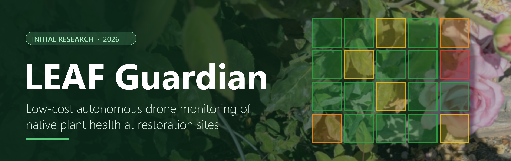
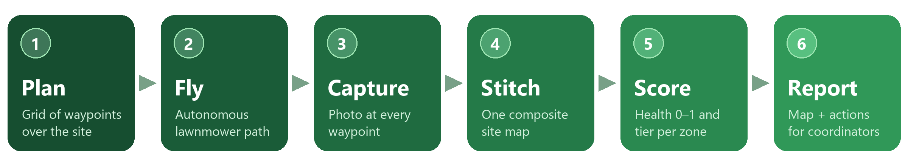
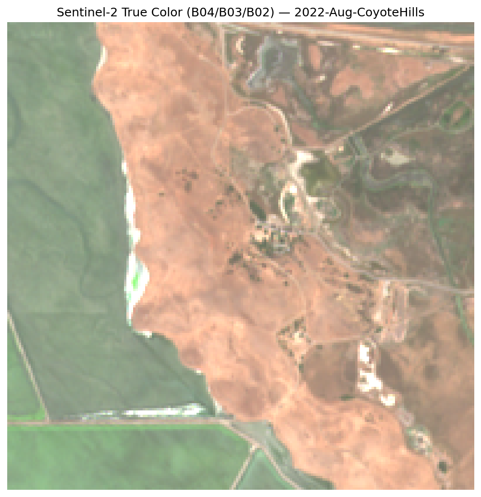
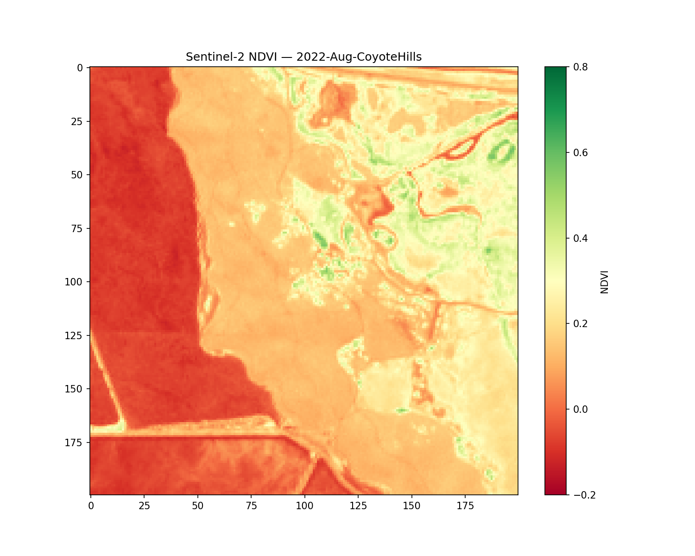
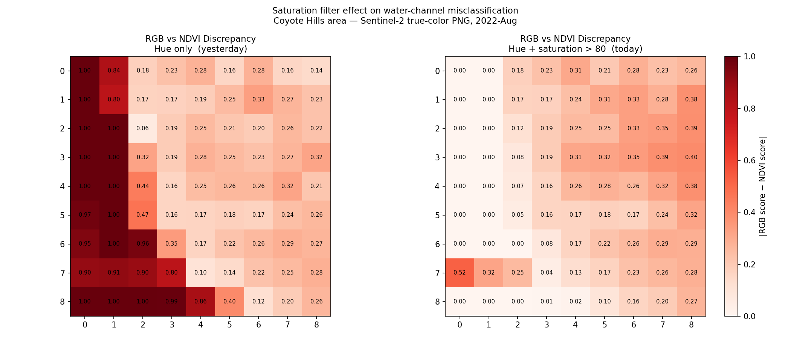
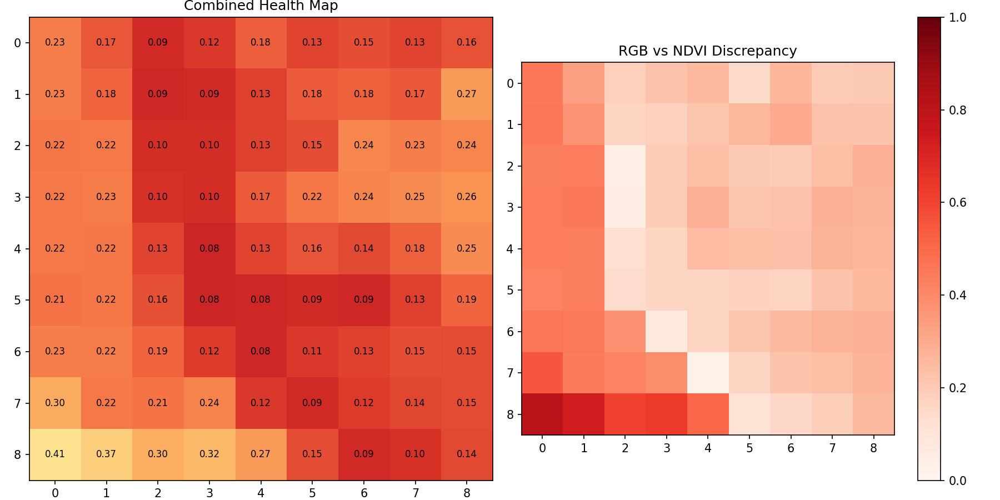
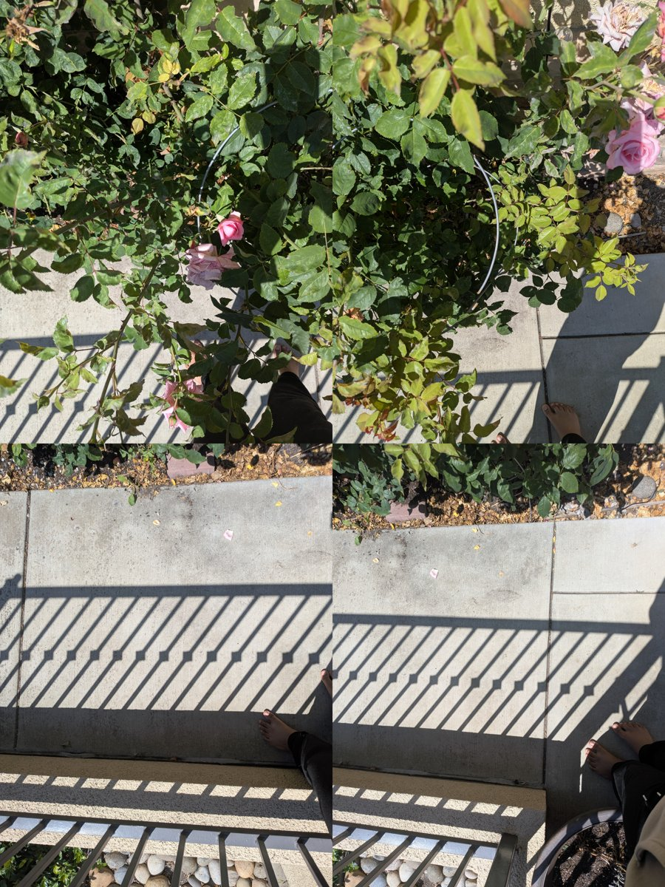
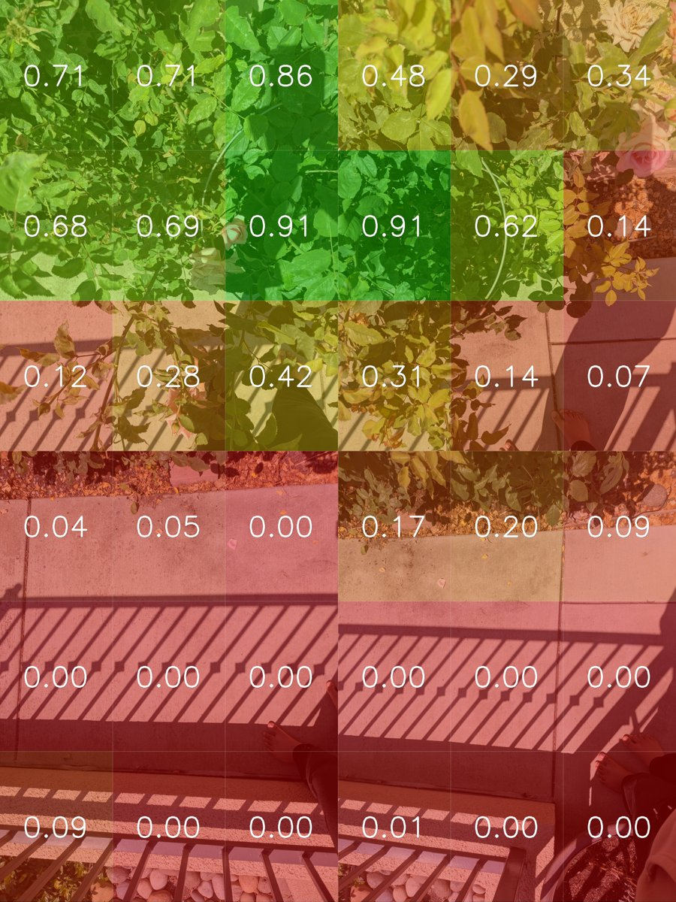
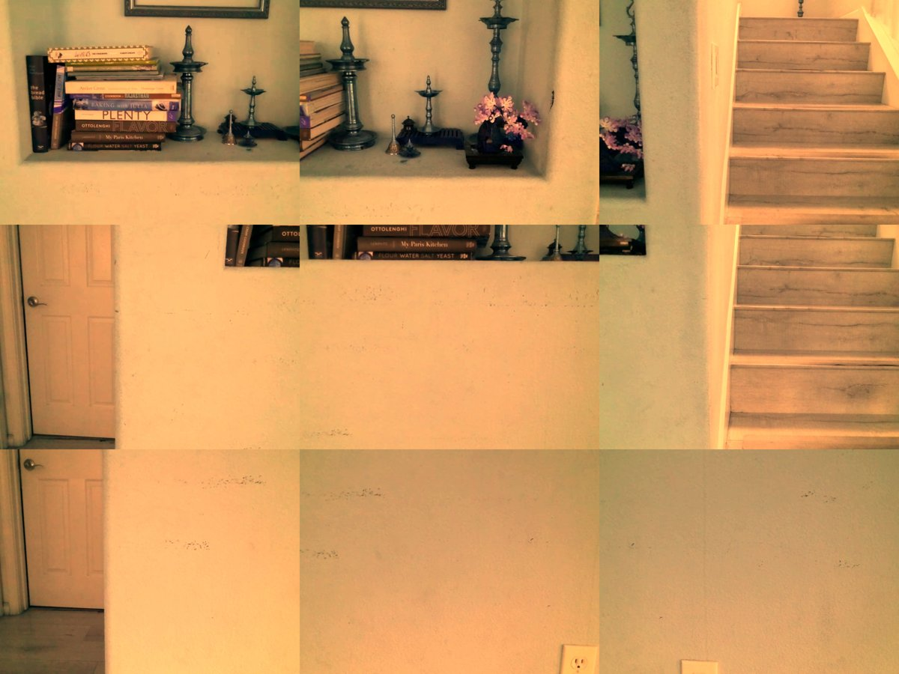
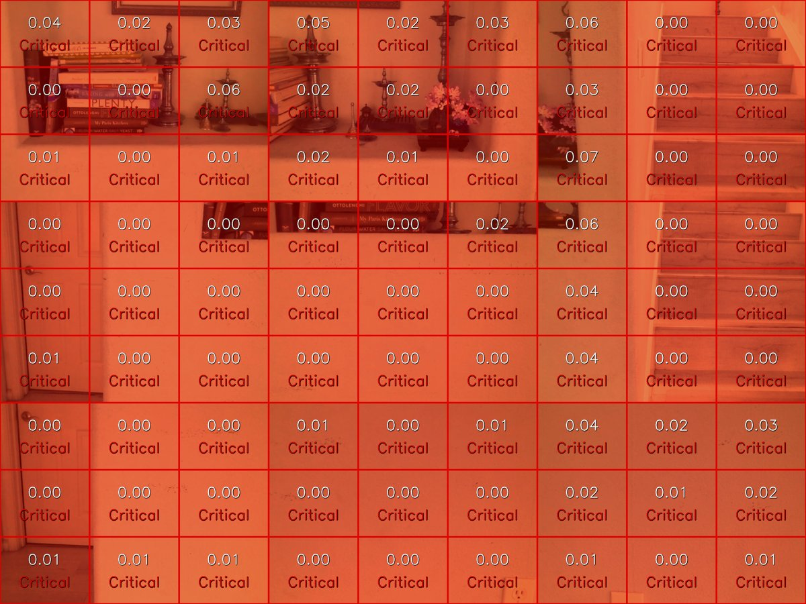

<p align="center">
  
</p>

<p align="center">
  
  
  
  
  
</p>

<p align="center">
  <a href="docs/PROJECT_PROPOSAL.md"><b>📄 Project Proposal</b></a> &nbsp;·&nbsp;
  <a href="#problem"><b>The Problem</b></a> &nbsp;·&nbsp;
  <a href="#how-it-works"><b>How It Works</b></a> &nbsp;·&nbsp;
  <a href="#software"><b>Software</b></a> &nbsp;·&nbsp;
  <a href="#hardware"><b>Hardware</b></a> &nbsp;·&nbsp;
  <a href="#next-steps"><b>Next Steps</b></a> &nbsp;·&nbsp;
  <a href="#get-started"><b>Get Started</b></a>
</p>

<br>

<p align="center">
  <b>LEAF Guardian</b> is a drone that surveys native-plant restoration sites on its own. It photographs every zone,<br>
  stitches the photos into one map, and tells volunteers <b>which plants need help before it's too late.</b>
</p>

<br>

<table align="center">
  <tr>
    <td align="center" width="200"><h2>~$660</h2>one-time cost<br><sub>vs. $18,000+ commercial</sub></td>
    <td align="center" width="200"><h2>1 script</h2>to run a survey<br><sub>no pilot or GIS training</sub></td>
    <td align="center" width="200"><h2>4 tiers</h2>of plant health<br><sub>with recommended actions</sub></td>
    <td align="center" width="200"><h2>Any day</h2>on-demand surveys<br><sub>vs. 1–3 visits per year</sub></td>
  </tr>
</table>

<br>

---

<a id="problem"></a>

## 🌱 The problem

Small environmental nonprofits plant thousands of native plants every year, but they have almost no way to tell which ones are struggling until it's too late.

A typical **restoration site coordinator** manages 5–20 sites on a budget of $30K–$150K, with a handful of trained volunteers. They check plants **by walking each site and judging by eye**, and can usually visit each site only **1–3 times a year**. They have no sensors, no satellite subscription, and no budget for either.

That visit schedule doesn't match how plants die:

| | Month 2 | Month 3 | Month 4 | Month 6 |
|:--|:--:|:--:|:--:|:--:|
| **Plant** | Early drought stress (visible only in near-infrared) | Slight yellowing | Browning, root damage | Dead |
| **Savable?** | ✅ Easily | ✅ 20-minute irrigation fix | ⚠️ Unlikely | ❌ Coordinator arrives too late |

> [!IMPORTANT]
> **The 60–90 day window where intervention would work passes unnoticed.** Restoration groups lose plants, volunteer effort, and grant money to problems that were fixable when they started.

### Why existing solutions fall short

| Alternative | Cost | The catch |
|:--|:--|:--|
| 🚶 **Manual field survey** *(today's default)* | Volunteer time | Needs botanical expertise, doesn't scale, leaves no consistent record, and misses early stress |
| 🛰️ **Satellite imagery** (Sentinel-2, Planet Labs) | Free to ~$1,500/mo | **10 m/pixel**: one pixel is bigger than a whole seedling cluster. Often blocked by clouds and fog, and needs GIS skills |
| 🧑‍✈️ **Professional aerial survey** (Zeitview, DroneBase) | $300–$5,000 per survey | $10K–$90K/year for regular monitoring, with 1–3 weeks of lead time |
| 🚁 **Commercial multispectral drone** (DJI Agras, MicaSense) | $18,000–$26,500+ | More than many nonprofits' annual budget, and requires an FAA Part 107 pilot |
| 🍃 **LEAF Guardian** | **~$400–$660 one-time** | Built for small volunteer organizations |

The real competitor is **a volunteer walking the site**. LEAF Guardian aims to be cheaper and easier than every technical option, and more consistent and earlier-warning than the manual one.

---

<a id="how-it-works"></a>

## ⚙️ How it works

<p align="center">
  
</p>

Every grid cell gets a **health score from 0 to 1** and a tier with a recommended action:

<table align="center">
  <tr>
    <td align="center">🟢<br><b>Healthy</b><br><sub>≥ 0.65</sub><br><sub>No action needed</sub></td>
    <td align="center">🟡<br><b>Monitor</b><br><sub>0.40 – 0.65</sub><br><sub>Inspect within 2 weeks</sub></td>
    <td align="center">🟠<br><b>Action Needed</b><br><sub>0.20 – 0.40</sub><br><sub>Irrigate and inspect within 1 week</sub></td>
    <td align="center">🔴<br><b>Critical</b><br><sub>&lt; 0.20</sub><br><sub>Immediate intervention</sub></td>
  </tr>
</table>

### Roadmap

| | Version | Goal |
|:--:|:--|:--|
| 🔨 | **V1: Proof of concept** *(current)* | Grid flight → photos → stitched map → RGB health scoring → report |
| ⏳ | **V2: Autonomous data collection** | GPS outdoor flight, onboard NDVI camera, overlap-aware stitching, multiple sites |
| ⏳ | **V3: Smarter analysis** | Machine-learning health classifier, RGB + NDVI cross-checking, confidence scores |
| ⏳ | **V4: Real-world deployment** | Web dashboard, historical tracking, user accounts, grant-ready impact reports |

---

<a id="software"></a>

## 💻 Design iterations: software

### Iteration 1 · Satellite data as a test bed

Before any drone was in hand, the whole analysis pipeline was built on **real Sentinel-2 satellite data** of **Coyote Hills Regional Park, Fremont CA** (12 Aug 2022), using a 2 km × 2 km crop split into a 9×9 grid. Two independent scores were computed from the same scene:

- **NDVI** from red + near-infrared bands: `(NIR − Red) / (NIR + Red)`, with each cell scored as `clip(mean, 0, 0.8) / 0.8`
- **Excess Green** from visible bands: `2G − R − B`, scored as `clip(mean, 0, 0.12) / 0.12`

These are combined per cell, and a **discrepancy layer** shows where visible color and near-infrared disagree.

<table>
  <tr>
    <td width="50%"></td>
    <td width="50%"></td>
  </tr>
  <tr>
    <td align="center"><sub><b>True color</b>: Sentinel-2 crop of Coyote Hills</sub></td>
    <td align="center"><sub><b>NDVI</b>: bay water on the left reads strongly negative</sub></td>
  </tr>
</table>

> [!TIP]
> **Key finding: water was being read as healthy plants.** Green-tinted bay water and algae have the same *hue* as leaves, so the color classifier scored them as healthy while NDVI correctly showed them as non-vegetation. A **saturation filter (S > 80)** fixed it, because water is washed out compared to real foliage.

<p align="center">
  
  <br><sub>Before (left) and after (right) the saturation filter. The block of false "healthy" water cells disappears.</sub>
</p>

<details>
<summary><b>More lessons from the satellite phase</b></summary>
<br>

1. **The first download was the entire 100 km × 100 km tile.** Drawing a box in Copernicus doesn't crop the file. The fix was a shared windowed read, `sentinel_utils.crop_band()`, so NDVI and RGB always cover exactly the same ground.
2. **The first crop landed on a residential neighborhood**, not the park. It had to be re-centered twice.
3. **Comparing unrelated images is meaningless.** An early test compared a houseplant photo to a satellite tile and showed near-total disagreement. Using the same scene and crop for both scores fixed that.
4. **How to read the discrepancy layer:**

| Pattern | Likely meaning |
|:--|:--|
| High NDVI, low RGB | Dry annual grass (near-infrared signal persists after visible green fades) |
| High RGB, low NDVI | Misclassification, or narrow shrubs that don't fill a 10 m cell |
| Both high | Healthy green woody vegetation |
| Both low | Bare soil, pavement, or water |

<p align="center">
  
</p>
</details>

> [!NOTE]
> At 10 m per pixel, a satellite **can't see individual plants**: one pixel is 100 m², and a seedling is under 1 m². That's why the project moved to drone imagery. The satellite pipeline is now a **baseline to compare against** and the place where the scoring, fusion, and reporting code was validated.

### Iteration 2 · Stitching real-world photos

Next, real plant photos were taken from overhead in a grid (`1.1` = top-left) to imitate a drone survey. **`stitch_grid.py`** auto-detects the grid size, assembles the tiles (letterboxing instead of cropping, so no data is lost), and scores the composite at 3× finer resolution.

<table>
  <tr>
    <td width="50%"></td>
    <td width="50%"></td>
  </tr>
  <tr>
    <td align="center"><sub><b>Stitched</b>: four overhead photos combined</sub></td>
    <td align="center"><sub><b>Scored</b>: dense leaves 0.7–0.9, yellowing lower, concrete and shadow ~0</sub></td>
  </tr>
</table>

#### How the RGB health analysis works

Each grid cell is scored by **two independent visible-light methods**, and the two scores are averaged.

<table>
<tr>
<td width="50%" valign="top">

**① HSV pixel classification**

Every pixel is converted to hue, saturation, and brightness, then sorted:

| Class | Rule |
|:--|:--|
| ⬛ Shadow *(excluded)* | V ≤ 30 |
| 🟦 Sky *(excluded)* | H 90–130, S > 50 |
| 🟩 **Green** | H 35–85, **S > 80** |
| 🟨 **Yellow** | H 20–35, S > 100, V > 100 |
| 🟫 **Brown** | H 10–35 |

`score = green / (green + ½·yellow + brown)`

Yellow counts half, because it's an earlier, still-recoverable stage.

</td>
<td width="50%" valign="top">

**② VARI index**

The *Visible Atmospherically Resistant Index* (Gitelson et al., 2002) is a published vegetation index that uses only red, green, and blue:

`VARI = (G − R) / (G + R − B)`

It's clipped to [−0.2, 0.6] and rescaled to 0–1, and is less sensitive to lighting than raw color thresholds.

**Final score** = average of ① and ②, mapped to a tier. A `health_report.txt` lists every zone that needs action.

</td>
</tr>
</table>

### Iteration 3 · Autonomous mission code

**`waypoint_mission.py`** flies a **lawnmower pattern**, captures `row.col.jpg` at every waypoint, stitches automatically after landing, and writes a JSON flight log (battery, duration, photos, results). A built-in **`MockTello`** imitates the drone, so the entire fly → stitch → analyze loop could be tested before the hardware arrived. Switching to the real drone takes a single `--real` flag.

<details>
<summary><b>Other code changes worth noting</b></summary>
<br>

- **Shared crop geometry** (`sentinel_utils.py`). Duplicate cropping code was merged after NDVI and RGB were found to cover slightly different areas.
- **Zero-score cells shown in black**, so "no vegetation" looks different from "unhealthy vegetation."
- **Fixed coordinate convention**: row 1 = top, column 1 = left, 1-indexed everywhere.
- **Tello capture fixes**: wait ~4 s after `streamon()`, discard early black frames, keep only frames that pass a brightness check, and correct the blue cast with three white-balance methods (channel scaling, histogram stretch, LAB + CLAHE).
- **Scores computed on the original full-resolution image**, never on the resized display copy.
</details>

---

<a id="hardware"></a>

## 🚁 Design iterations: hardware

<table>
<tr>
<td width="50%" valign="top">

### Drone 1 · DJI Tello
**~$150 · laptop-programmable in Python**

✅ Stable hover, single-axis moves, and a 60 cm square flown autonomously<br>
✅ A full 3×3 autonomous grid mission with photos at every waypoint<br>
❌ **Camera can't look down**. The downward camera is reserved for positioning.<br>
❌ **Strong blue color cast** and low-resolution frames<br>
❌ No GPS, so it drifts outdoors in wind

**Result:** proved that autonomous flight → photos → stitch → report works end to end, but the camera isn't suitable for plant monitoring.

</td>
<td width="50%" valign="top">

### Drone 2 · DJI Mini 4K
**~$299 · high-quality camera**

✅ **3-axis gimbal that tilts straight down (−90°)**<br>
✅ Much better image quality and color accuracy<br>
✅ GPS-stabilized outdoor flight<br>
❌ **No autonomous flight**: no waypoint missions and no laptop control<br>
❌ Photos moved to the computer by **microSD card**

**Result:** flown manually over a grid to test the aerial-photo → analysis pipeline with real drone images.

</td>
</tr>
</table>

<table>
  <tr>
    <td width="50%"></td>
    <td width="50%"></td>
  </tr>
  <tr>
    <td colspan="2" align="center"><sub><b>First real autonomous Tello mission</b>: 9 photos on a 3×3 grid, stitched and scored. The indoor scene has no plants, so every cell correctly scores Critical.</sub></td>
  </tr>
</table>

<!-- TODO: add Mini 4K aerial photos, e.g.
<table><tr>
  <td width="50%"></td>
  <td width="50%"></td>
</tr></table>
-->

> [!NOTE]
> **The Tello has autonomy but the wrong camera. The Mini 4K has the right camera but no autonomy.** Neither does everything the project needs, which shapes the next step.

<details>
<summary><b>Tello troubleshooting log</b></summary>
<br>

| Problem | Cause | Fix |
|:--|:--|:--|
| Can't look down | `downvision` command only works on the Tello EDU | Fly a *vertical* grid with the forward camera |
| Blue color cast | Camera white balance | Partly corrected in software |
| Flips fail | Disabled below ~40–50% battery; needs altitude | Battery check plus climb before maneuvers |
| `Motor stop` / `Not joystick` | Drone stuck out of SDK mode | Power-cycle between sessions; wait 2 s after `connect()` |
| Black first frames | Video stream needs time to start | Wait ~4 s and discard early frames |
</details>

<details>
<summary><b>Drones evaluated and rejected</b></summary>
<br>

| Drone | Why not |
|:--|:--|
| Parrot ANAFI 4K | Open Python SDK and a good gimbal, but discontinued with no parts or support |
| DJI Mini 4 Pro (~$759) | Has waypoints but is still phone-controlled. Kept as a fallback. |
| Prebuilt F450 kits from unverified sellers | Suspicious pricing, and included cameras don't support NDVI |
| Holybro X500 / S500 | Good quality, but costs more than building an F450 |
</details>

---

<a id="next-steps"></a>

## 🚀 Next steps

<table>
<tr>
<td width="50%" valign="top">

### 🧠 Software

**Neural-network health classifier.** Replace hand-tuned color thresholds (which break under different lighting, shadows, and species) with a model that *learns* the signs of declining plant health.

- **Transfer learning** from a pretrained network (ResNet18 / MobileNetV2)
- Train on field-condition stress datasets: **PlantSeg**, **OLID I** (drought and nutrient stress), **AMG_HS**, **PlantDoc**, **PlantDiseaseNet**
- **Labeling tool** so every flight adds training data
- **Fine-tune on CA LEAF imagery**. No public dataset of California native-plant health exists yet.

**Also:** confidence scores for uncertain cells, and USDA **NAIP** imagery (60 cm/pixel) as a higher-resolution aerial baseline.

</td>
<td width="50%" valign="top">

### 🛠️ Hardware

**A custom, non-prebuilt drone** combining the Tello's autonomy with the Mini 4K's camera quality. The leading candidate is an **F450 quadcopter** with:

- **Laptop Python control** (DroneKit / MAVLink) with real **GPS waypoints**
- **Raspberry Pi** with a **downward camera**, including a **NoIR camera for NDVI**
- Photos pulled over Wi-Fi instead of by microSD, with analysis **onboard** later
- **Simulator (SITL)** testing before every real flight
- About **$660 total**

Most of the pipeline (`stitch_grid`, `rgb_health`, reports) carries over unchanged.

</td>
</tr>
</table>

### 🌾 Field work
Collect real survey imagery at CA LEAF planting sites, and get feedback from coordinators on which stress signs matter most in the field.

---

<a id="get-started"></a>

## 🧪 Get started

```bash
git clone https://github.com/Aarush-Sundararajan/leaf-guardian.git
cd leaf-guardian
py -m pip install numpy matplotlib rasterio opencv-python djitellopy
```

| Try it | Command |
|:--|:--|
| Mock drone survey *(no hardware)* | `py software/tello_control/waypoint_mission.py` |
| Stitch + analyze a photo grid | `py software/ndvi_pipeline/stitch_grid.py data/drone_imagery/grid_test` |
| Satellite pipeline *(needs Sentinel-2 bands)* | `py software/ndvi_pipeline/run_combined.py` |
| Live Tello mission *(on Tello Wi-Fi)* | `py software/tello_control/waypoint_mission.py --real` |

> [!WARNING]
> Run every script from the **repo root**. Data paths are relative.

<details>
<summary><b>Repository layout</b></summary>
<br>

```
leaf-guardian/
├── data/
│   ├── sentinel_data/        # Sentinel-2 bands (gitignored) + NDVI, RGB, grid, combined outputs
│   ├── drone_imagery/        # test photos, grid_test (real), survey (mock), vertical_grid (Tello)
│   └── flight_logs/          # JSON logs written by each mission
├── docs/                     # project proposal, flight plan, README images
└── software/
    ├── ndvi_pipeline/        # satellite NDVI/RGB, rgb_health, stitch_grid, combine_maps
    └── tello_control/        # waypoint + vertical grid missions, hardware test scripts
```

| Script | What it does |
|:--|:--|
| `ndvi_pipeline/run_combined.py` | Full satellite pipeline (RGB → NDVI → combine) |
| `ndvi_pipeline/sentinel_ndvi.py` | NDVI map and scored grid from Sentinel-2 B04/B08 |
| `ndvi_pipeline/sentinel_rgb.py` | True-color image and Excess Green health grid |
| `ndvi_pipeline/combine_maps.py` | Averages RGB and NDVI scores; discrepancy layer |
| `ndvi_pipeline/rgb_health.py` | HSV + VARI health scoring, tiers, text report |
| `ndvi_pipeline/stitch_grid.py` | Stitches `row.col.jpg` tiles and analyzes the composite |
| `tello_control/waypoint_mission.py` | Lawnmower survey (mock by default, `--real` for Tello) |
| `tello_control/vertical_grid_mission.py` | Vertical-grid survey with the Tello's forward camera |
| `tello_control/test_*.py` | Individual hardware tests (hover, move, square, capture, …) |
</details>

---

<p align="center">
  <b>LEAF Guardian</b> · built in partnership with <b>CA LEAF</b><br>
  <sub><a href="docs/PROJECT_PROPOSAL.md">Project Proposal</a> · <a href="DEVLOG.md">Development Log</a> · Targeting Regeneron STS & ISEF 2027</sub>
</p>
